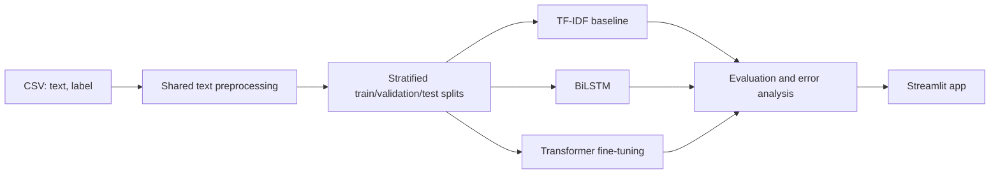

# Hinglish Sentiment Analysis

A college mini-project that classifies Hindi written in Roman script mixed with English (Hinglish) as **positive**, **negative**, or **neutral**. It compares classical TF-IDF models, a BiLSTM, and a fine-tuned multilingual transformer, then exposes locally available trained models through Streamlit.

Hinglish is difficult because it has no standard spelling (for example, `bahut`, `bohot`, and `bht`), is code-mixed, and often uses slang, negation, sarcasm, and emojis.

> **Project status: complete.** Results below are from real SentiMix Hinglish train/dev data, re-split with a fixed 70/15/15 stratified split. The bundled 30-row sample remains smoke-test-only and must never be reported as project performance.

## Architecture



## Dataset

Place a real CSV at `data/raw/hinglish_sentiment.csv` (or pass `--input`) with logical columns `text` and `label`. Supported source options include SemEval-2020 Task 9 (SentiMix Hinglish), GLUECoS Hinglish sentiment, a Kaggle Hinglish dataset, or your own carefully self-labelled CSV.

Check a source's licence, label definitions, and split policy before using it. Configure dataset-specific labels in `config.yaml` under `label_mapping`; string labels are case-insensitive and numeric values must be explicitly mapped. Canonical classes are `negative`, `neutral`, and `positive`.

`data/sample/hinglish_smoke_sample.csv` contains 30 hand-written examples only to verify loading, cleaning, and splitting. It is tiny and balanced. **Do not use it for model scores, comparison, or conclusions.**

## Setup and Phase 1

```bash
cd hinglish-sentiment
python -m venv .venv
# Windows PowerShell
.venv\Scripts\Activate.ps1
pip install -r requirements.txt

# The deliberately tiny, non-evaluative sample
python -m src.data_loader --sample
pytest -q

# After obtaining a real CSV
python -m src.data_loader --input data/raw/hinglish_sentiment.csv
```

The split command writes `train.csv`, `validation.csv`, and `test.csv` to `data/processed/`, logs class distributions, and includes an integer `label_id` based on `label_order`. It uses fixed-seed 70/15/15 stratification.

### Convert downloaded SentiMix data

The official Hinglish files are token-per-line CoNLL files, so convert the
labelled training and development files before running the data loader:

```powershell
python -m src.convert_sentimix --train "C:\path\to\Hinglish_train_14k_split_conll.txt" --dev "C:\path\to\Hinglish_dev_3k_split_conll.txt"
```

This creates `data/raw/hinglish_sentiment.csv`. It intentionally excludes the
official unlabelled test file and its labels to prevent test-data leakage.

## Planned commands

```bash
make data
make baseline
make bilstm
make finetune
make eval
make app
```

## Phase 2: classical baseline

After Phase 1 has generated the processed splits, run:

```bash
python -m src.baseline
# or: make baseline
```

This fits TF-IDF word 1-2 grams plus character 3-5 grams, then trains
class-balanced Logistic Regression and Linear SVM models. It saves trained
models to `models/`, and test-set metrics, classification reports, and one
confusion-matrix image per model to `results/`.

## Phase 3: BiLSTM

```bash
python -m src.bilstm
# or: make bilstm
```

The BiLSTM vocabulary is built from the training split only; unseen words map
to an OOV token and batches use padding. Training uses class-weighted loss and
early stopping based on validation macro-F1. The best checkpoint is saved as
`models/bilstm_best.pt`; plots and held-out test metrics are saved in
`results/`.

## Phase 4: transformer fine-tuning

Run full fine-tuning on a free Colab or Kaggle GPU, not an ordinary CPU laptop.
The notebook at `notebooks/colab_finetune.ipynb` installs dependencies,
uploads your local `hinglish_sentiment.csv`, fine-tunes XLM-RoBERTa, and
downloads the resulting artifacts. Replace its `REPO_URL` placeholder with
your GitHub repository URL first.

```bash
# GPU: one model
python -m src.transformer_finetune --models xlm-roberta-base

# CPU: debugging only; downloads the selected pretrained model
python -m src.transformer_finetune --quick --models xlm-roberta-base
```

The configured candidates are HingBERT, MuRIL, XLM-RoBERTa, and multilingual
BERT. Multiple identifiers can be passed after `--models` for sequential
comparison. Training uses weighted cross-entropy, macro-F1 checkpoint
selection, epoch evaluation, and early stopping.

## Phase 5: evaluation and error analysis

```bash
make eval
# equivalent:
python -m src.evaluate
python -m src.error_analysis
```

This produces `results/model_comparison.csv` and `model_comparison.png`
from saved, completed model metrics. Error analysis writes one
`*_misclassified.csv` file per locally available model with true/predicted
labels, confidence, and transparent heuristic categories. It also creates a
short text summary per model. Categories are guides for manual review, not
claims about the underlying linguistic cause.

## Results

The values below are from saved outputs in results/ using the 2,550-example
held-out test split. XLM-RoBERTa was trained on a Colab Tesla T4 GPU; the other
models were trained on CPU.

| Model | Accuracy | Macro-F1 | Training time |
|---|---:|---:|---:|
| XLM-RoBERTa | **63.33%** | **63.43%** | 543.36 s |
| Logistic Regression | 62.86% | 63.21% | 1.17 s |
| Linear SVM | 60.55% | 60.95% | 0.80 s |
| BiLSTM | 56.75% | 57.37% | 51.06 s |

XLM-RoBERTa achieved the best macro-F1, but its gain over Logistic Regression
was small (0.22 percentage points) while training was much slower. This shows
why a character-aware TF-IDF baseline is competitive for noisy Hinglish text.

Error analysis exported every misclassified test example with confidence and
heuristic categories. XLM-RoBERTa misclassified 935/2,550 comments (36.7%);
Logistic Regression misclassified 947 (37.1%); and BiLSTM misclassified 1,103
(43.3%). Negation/sarcasm-like patterns were the most frequent identifiable
heuristic category. These labels are guides for manual review, not causal proof.

## Project structure

```text
hinglish-sentiment/
├── app/                 # Streamlit app (Phase 6)
├── data/                # raw, processed, and smoke-test data
├── models/              # checkpoints
├── notebooks/           # Colab notebook (Phase 4)
├── results/             # metrics and plots
├── src/                 # training and evaluation code
└── tests/
```

## Streamlit app

Run the app with:

```powershell
streamlit run app/streamlit_app.py
```

Open http://localhost:8501. Select any locally available model, enter a
Hinglish comment or click an example, and inspect its confidence chart. Batch
mode accepts a CSV containing a text column and provides a predictions download.

## Windows convenience script

Make is optional and normally not installed on Windows. Use the commands above
or the helper script:

```powershell
.\scripts\run_project.ps1 test
.\scripts\run_project.ps1 evaluate
.\scripts\run_project.ps1 app
```

## Limitations

- SentiMix is social-media data and cannot represent every Hinglish spelling
  style, domain, or community.
- The 70/15/15 re-split supports one consistent project comparison, but is not
  identical to the official shared-task protocol.
- Confidence is a model score, not a guarantee of correctness.
- Sarcasm, subtle mixed sentiment, and informal spelling remain difficult.

## Future work

Emotion detection, Marathi-English support, aspect-based sentiment, and a
YouTube-comment dashboard are natural extensions.

## Viva quick questions

1. **Why macro-F1?** It gives each sentiment class equal importance and is
   more informative than accuracy when classes are not perfectly balanced.
2. **Why stratified splitting?** It preserves class proportions in train,
   validation, and test partitions.
3. **Why build the BiLSTM vocabulary only from training data?** It prevents
   information leakage from validation/test text.
4. **Why use character TF-IDF?** Hinglish has spelling variation such as
   bahut, bohot, and elongated words; character n-grams capture it.
5. **Why did Logistic Regression nearly match XLM-RoBERTa?** Strong TF-IDF
   features can be very effective for short, lexical social-media sentiment
   data; the transformer’s context advantage was modest here.
6. **Why use class-weighted loss?** It reduces bias toward the more common
   neutral class.
7. **Why keep official SentiMix test files separate?** To prevent test
   leakage and preserve a possible external evaluation set.
8. **What is early stopping?** Training stops when validation macro-F1 no
   longer improves, limiting overfitting.
