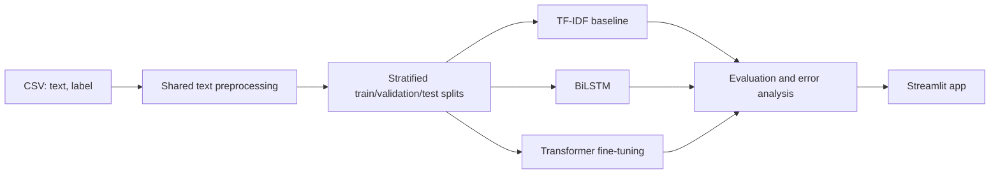

# Hinglish Sentiment Analysis

A college mini-project that classifies Hindi written in Roman script mixed with English (Hinglish) as **positive**, **negative**, or **neutral**. It will compare classical TF-IDF models, a BiLSTM, and fine-tuned multilingual transformers, then expose the best available model through Streamlit.

Hinglish is difficult because it has no standard spelling (for example, `bahut`, `bohot`, and `bht`), is code-mixed, and often uses slang, negation, sarcasm, and emojis.

> **Current status: Phase 1 completed and smoke-tested.** No real dataset was downloaded. The bundled sample is only a pipeline check; its results are scientifically meaningless and must not be reported as project performance.

## Architecture



## Dataset

Place a real CSV at `data/raw/hinglish_sentiment.csv` (or pass `--input`) with logical columns `text` and `label`. Supported source options include SemEval-2020 Task 9 (SentiMix Hinglish), GLUECoS Hinglish sentiment, a Kaggle Hinglish dataset, or your own carefully self-labelled CSV.

Check a source's licence, label definitions, and split policy before using it. Configure dataset-specific labels in `config.yaml` under `label_mapping`; string labels are case-insensitive and numeric values must be explicitly mapped. Canonical classes are `negative`, `neutral`, and `positive`.

`data/sample/hinglish_smoke_sample.csv` contains 30 hand-written examples only to verify loading, cleaning, and splitting. It is tiny and balanced. **Do not use it for model scores, comparison, or conclusions.**

## Setup and Phase 1

```bash
cd hinglish-sentiment
python -m venv .venv
# Windows PowerShell
.venv\Scripts\Activate.ps1
pip install -r requirements.txt

# The deliberately tiny, non-evaluative sample
python -m src.data_loader --sample
pytest -q

# After obtaining a real CSV
python -m src.data_loader --input data/raw/hinglish_sentiment.csv
```

The split command writes `train.csv`, `validation.csv`, and `test.csv` to `data/processed/`, logs class distributions, and includes an integer `label_id` based on `label_order`. It uses fixed-seed 70/15/15 stratification.

### Convert downloaded SentiMix data

The official Hinglish files are token-per-line CoNLL files, so convert the
labelled training and development files before running the data loader:

```powershell
python -m src.convert_sentimix --train "C:\path\to\Hinglish_train_14k_split_conll.txt" --dev "C:\path\to\Hinglish_dev_3k_split_conll.txt"
```

This creates `data/raw/hinglish_sentiment.csv`. It intentionally excludes the
official unlabelled test file and its labels to prevent test-data leakage.

## Planned commands

```bash
make data
make baseline
make bilstm
make finetune
make eval
make app
```

## Phase 2: classical baseline

After Phase 1 has generated the processed splits, run:

```bash
python -m src.baseline
# or: make baseline
```

This fits TF-IDF word 1-2 grams plus character 3-5 grams, then trains
class-balanced Logistic Regression and Linear SVM models. It saves trained
models to `models/`, and test-set metrics, classification reports, and one
confusion-matrix image per model to `results/`.

## Phase 3: BiLSTM

```bash
python -m src.bilstm
# or: make bilstm
```

The BiLSTM vocabulary is built from the training split only; unseen words map
to an OOV token and batches use padding. Training uses class-weighted loss and
early stopping based on validation macro-F1. The best checkpoint is saved as
`models/bilstm_best.pt`; plots and held-out test metrics are saved in
`results/`.

## Phase 4: transformer fine-tuning

Run full fine-tuning on a free Colab or Kaggle GPU, not an ordinary CPU laptop.
The notebook at `notebooks/colab_finetune.ipynb` installs dependencies,
uploads your local `hinglish_sentiment.csv`, fine-tunes XLM-RoBERTa, and
downloads the resulting artifacts. Replace its `REPO_URL` placeholder with
your GitHub repository URL first.

```bash
# GPU: one model
python -m src.transformer_finetune --models xlm-roberta-base

# CPU: debugging only; downloads the selected pretrained model
python -m src.transformer_finetune --quick --models xlm-roberta-base
```

The configured candidates are HingBERT, MuRIL, XLM-RoBERTa, and multilingual
BERT. Multiple identifiers can be passed after `--models` for sequential
comparison. Training uses weighted cross-entropy, macro-F1 checkpoint
selection, epoch evaluation, and early stopping.

## Results

TO BE FILLED AFTER TRAINING ON A REAL DATASET. No metrics are invented in this README.

## Project structure

```text
hinglish-sentiment/
├── app/                 # Streamlit app (Phase 6)
├── data/                # raw, processed, and smoke-test data
├── models/              # checkpoints
├── notebooks/           # Colab notebook (Phase 4)
├── results/             # metrics and plots
├── src/                 # training and evaluation code
└── tests/
```

## Limitations and future work

This project will depend on chosen-data quality and coverage. Romanized Hindi is ambiguous, and heuristic preprocessing cannot reliably detect sarcasm or context. Future extensions include emotion detection, Marathi-English, aspect-based sentiment, and a YouTube-comment dashboard.
